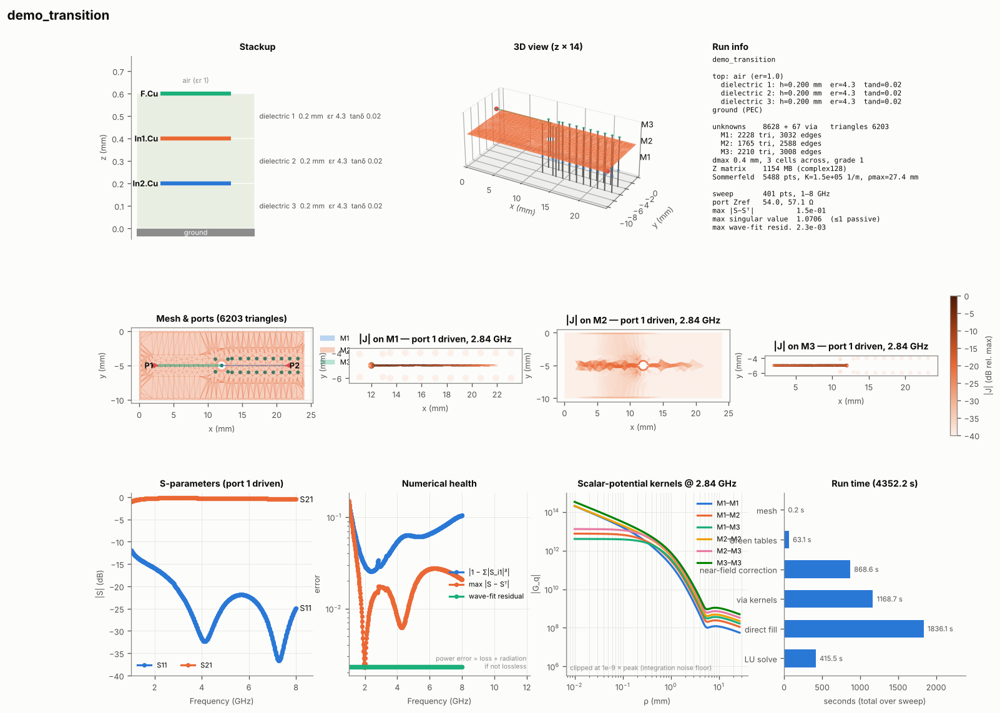

# mom25d — an open-source 2.5D Method-of-Moments solver for PCB structures

A planar (2.5D) full-wave MoM electromagnetic solver in Python (NumPy/SciPy, shapely, triangle),
aimed at signal-integrity and RF structures on multilayer boards: traces, couplers, via
transitions, planes, CPWG. Feed it a KiCad board (or Gerbers) with port footprints, get
Touchstone S-parameters and a diagnostic dashboard out.


## Quick start

```bash
pip install -e .                                            # or: pip install -r requirements.txt
python src/mom25d/core/build.py                             # optional C++/OpenMP core (needs g++, pybind11)
python -m pytest tests -q                                   # ~1 min with the core

# KiCad board -> S-parameters (example board generated by a script; no KiCad needed)
python examples/make_demo_board.py examples/demo_transition
mom25d examples/demo_transition.kicad_pcb --config examples/demo_transition.mom25d.toml
```



*Example: `examples/demo_transition.kicad_pcb` — F.Cu microstrip → blind via → In2.Cu stripline,
In1.Cu GND plane with antipad, GND via fence; 8.7k unknowns, 19 EM solves for a 401-point sweep
(adaptive), `direct` solver. Results in `results/demo_transition.s2p`. Wave-port separation is
reliable above ~1.4 GHz for this feed length (the solver warns below).*

## KiCad workflow

1. **Ports.** Place a port footprint (e.g. `mom25d:RF_Port`, no copper) at the end of each
   feed, with a user text **`P1`, `P2`, …** on the Fab layer. The footprint position is the port
   location and its rotation is the direction *into* the circuit (0° = +x). Optional footprint
   fields:
   * `mom.port` = `wave` (default when a straight feed exists: de-embedded travelling-wave port,
     reference plane at the footprint), `via` (lumped port to the ground layer), `gap`
   * `mom.layer` = copper layer of the port (inner-layer striplines), `mom.z0`, `mom.ref` (mm shift)
2. **Pick-and-place** (`.pos` / `.csv`) lists the port components (Value or Reference `P<n>`, or a
   package containing "PORT"); it is required for the Gerber path.
3. **Stackup** is read from *Board Setup → Physical Stackup* (copper, dielectric thickness, εr,
   loss tangent, solder mask, dielectric sub-layers). Pick the copper layer that acts as the
   infinite ground (`--ground B.Cu`); other copper (planes, pours) is meshed metal. `--cover`
   turns a copper layer into a PEC cover for stripline-only models.
4. **Run** `mom25d board.kicad_pcb --pos board-top.pos --nets RF,GND --ground B.Cu
   --fmin 0.5 --fmax 10`, or put the options in a TOML file (`--config`). Outputs: `.sNp`,
   `_dashboard.png`, `_summary.json`.
5. **Gerber fallback:** `mom25d fab/board-job.gbrjob --pos board-top.pos ...` — the stackup
   comes from the KiCad job file; copper from RS-274X/X2; vias from Excellon (blind/buried spans
   from the X2 attribute). Gerbers have no nets: crop with `--region`.

**Differential ports.** Give the two legs Fab texts **`P1+` / `P1-`** (or `P1P` / `P1N`), one footprint
per trace. The pair becomes one mixed-mode port with differential (`P1d`, Z = 2·Z_odd) and common
(`P1c`, Z = Z_even/2) modes, both extracted from a coupled-line modal fit. The output is a
mixed-mode Touchstone 2.0 file with per-port `[Reference]` impedances (e.g. Sdd21 = S(3,1),
Scd21 = S(4,1) for two pairs). Example: `python examples/make_demo_board.py examples/demo_diff diff`.

Each wave port's reference impedance is computed automatically from its cross-section (trace plus
the metal covering it) and the result is renormalised to `--z0`.

## GPU acceleration (AMD ROCm or NVIDIA CUDA)

The mixed-precision direct solver can run its LU factorisation and preconditioner solves on a GPU
in complex64. The matrix fill and the double-precision refinement stay on the CPU, so results
match the CPU solver (|ΔS| < 1e-7 in the tests). Two backends, tried in this order:

| Backend | Install | VRAM for N unknowns | 16 GB card |
|---|---|---|---|
| CuPy (hipSOLVER / cuSOLVER) | CuPy for ROCm, see the CuPy install docs | 8 N² B (LU in place) | ~41k |
| PyTorch (ROCm or CUDA build) | the ROCm wheel command from pytorch.org | 16 N² B | ~29k |

```bash
mom25d --gpu-info                           # what was detected
python tools/gpu_selfcheck.py                # accuracy + speed check on your card
mom25d board.kicad_pcb ... --gpu auto|cupy|torch|off
```

The GPU is used automatically (`--gpu auto`) when a backend is installed and the LU fits in free
VRAM; otherwise the CPU LU runs with a note in the log. `MOM25D_GPU=off` disables it. AMD notes:
check the card with `rocminfo`; consumer RDNA3 cards other than the 7900 series usually need
`HSA_OVERRIDE_GFX_VERSION=11.0.0` (RDNA2: `10.3.0`).

## What's inside

The package lives in `src/mom25d/` (`import mom25d.sim`, …); the command line is `mom25d` (`python -m mom25d.cli`).

| Module | Contents |
|---|---|
| `base.py` | Stage 1: microstrip MPIE/RWG, analytic singular integrals, port extraction |
| `multilayer.py` | Layer stacks (open / PEC cover), TL-network layered Green's functions, singular and nearest-image extraction, tensor mesher |
| `geo.py` | Polygon mesher (constrained Delaunay, edge-graded rings, port lines, vias, regional refinement), `LinePort` |
| `via.py` | Vertical-current kernels in layered media (via–strip, via–via) |
| `sing.py` | Analytic off-plane 1/R integrals (thin layers, two-sheet conductors) |
| `sim.py` | `Simulation`: polygons, vias, wave/gap/via ports, lumped R-L-C, metal loss, thick conductors, solvers |
| `fast.py` | Fast operator: far/near split, `direct` / `mixed` / `blr` / `aca` solvers |
| `gpu.py` | GPU LU backends (CuPy / PyTorch, ROCm or CUDA) for the mixed direct solver |
| `blr.py` | Block low-rank LU (tile LU, SVD compression) used as a GMRES preconditioner |
| `core/mom25d_core.cpp` (`mom25d._core`) | C++/OpenMP kernels via pybind11: matrix fill, near correction, matrix-free matvec |
| `afs.py` | Adaptive frequency sweep (set-valued AAA rational fitting) |
| `kicad.py`, `gerber.py` | Board import → `BoardModel` → `Simulation` |
| `viz.py` | Dashboard: stackup, 3D view, mesh/ports/vias, currents, S-params, numerical health, kernels, timing |
| `cli.py` | Command-line runner |

**Formulation.** Mixed-potential integral equation with RWG basis functions; layered-media
kernels from a spectral transmission-line network (TE/TM), Sommerfeld integrals on a deformed
contour. Singular (1/ρ), near-singular cross-layer (1/√(ρ²+d²)) and nearest-image terms are
extracted and integrated analytically. Vias are thin wires with constant current per layer span
("chains"); their end charges are spread over the pad's vertex fan so they cancel the pad's own
charge exactly. Lumped elements are rank-one updates across a cut line or a via.

**Solvers.** `dense` (reference), `direct` (dense LU of the fast operator: centroid far field +
exact sparse near field; memory ≈ Z only), `mixed` (Z and LU in complex64, refined to double
accuracy by GMRES on the exact matrix-free operator; half the memory, |ΔS| ~ 1e-10), `blr`
(block low-rank LU preconditioner + exact matrix-free GMRES; lowest memory), `aca` (H-matrix +
GMRES). `auto` picks by size: dense ≤ 3.5k, mixed ≤ 14k, then blr.

**Performance** (cropped demo board, 8.3k unknowns, one frequency, 4 threads):

| | time | peak memory |
|---|---|---|
| pure NumPy, double | 150 s | 4.05 GB |
| C++ core, double (`direct`) | 28 s | 2.35 GB |
| C++ core, `mixed` | 18.6 s | 1.51 GB |
| C++ core, `blr` | 56–78 s | 1.00 GB |

Kernels moved to C++: far-field fill 62 s → 1.0 s, near correction 21 s → 2.3 s. The remaining time
is the LU (LAPACK, already threaded). Set `MOM25D_NO_CORE=1` to force the NumPy path.

## Validation (all in `tests/`)

| Check | Result |
|---|---|
| Layered Green's functions vs exact images (on/between interfaces) | ~1e-5 |
| Via kernels vs exact image solution (air, homogeneous dielectric) | ~1e-6 |
| Stripline Z0 vs Cohn / ε_eff | 0.6 % / 0.01 % |
| Broadside coupler vs coupled-line theory; power balance (lossless) | ~0.1 dB; 1 − 1e-9 |
| Series R / C in a line vs circuit theory | < 0.5 % |
| Via to ground vs Goldfarb–Pucel | +10 % (current crowding from the wide line, expected) |
| Two-sheet thick conductor vs 2D finite-thickness solver | 85–95 % of the thickness effect |
| Power plane cavity resonances vs cavity model (ACA + AFS, 17 solves) | within 0.7 % |
| Gerber round trip vs native KiCad import | copper identical to < 0.02 mm² |
| Coupled stripline Z_even / Z_odd vs Cohn | < 2.5 % |
| Straight differential line: \|Sdd21\|, mode conversion | 1 ± 2e-3; Scd < 1e-3 |
| C++ core vs NumPy; mixed / BLR vs double | 1e-10 / ~1e-9 |

## Limits and next steps

* Port de-embedding needs a straight feed of ≳ λ/8 at the lowest frequency; cuts must stay
  clear of discontinuities (the solver warns when the wave fit degrades).
* Thick conductors are an optional two-sheet model (≥ ~18 µm validated); default is zero thickness.
* Iterative (ACA) convergence slows near plane-pair resonances; `mixed` is the robust choice up
  to ~15k unknowns (≈ 3 GB at 12k); `blr` goes further on memory. Beyond ~50k unknowns a
  hierarchical LU (or STRUMPACK/MUMPS BLR) would be the next step.
* Not yet: dielectric/copper roughness models, KiCad custom-pad primitives
  beyond polygons/circles/lines, Calderón-type preconditioning.
