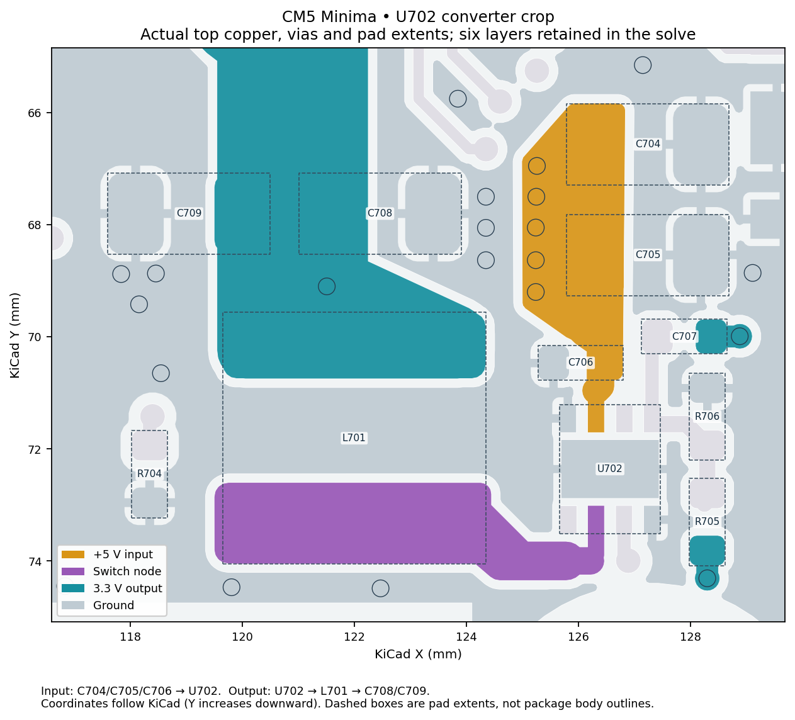
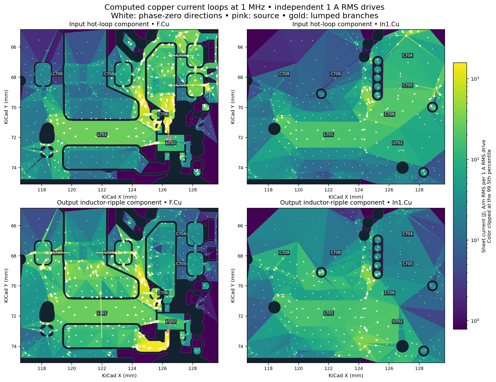
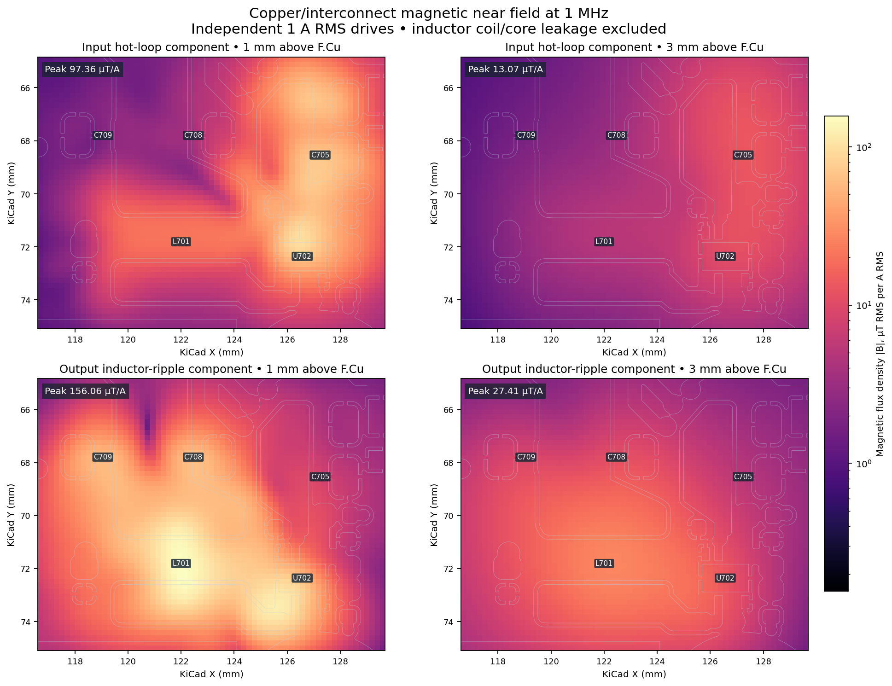

# CM5 U702 converter: current loops and magnetic near fields

This illustrative model retains all six copper layers and the +5V, GND,
SW and M2_3V3 nets around U702/L701, with explicit input/output capacitors
and the 2.2 uH inductor. Source revision and board provenance are documented
in [the input-loop benchmark](../cm5-u702.md); the exported JSON hash and
all numerical settings are in [summary.json](summary.json).

Reproduce from an exported CM5 board JSON:

```sh
OPENBLAS_NUM_THREADS=2 python tools/cm5_converter_fields.py CM5_MINIMA_3_board.json --out cm5-fields
```

The script also exports complex currents/fields, all-layer maps, phase
animations, a PDF report and standard kicad2ems field dumps. Re-render a
saved run with `--out cm5-fields --render-only`.

## Excitation and interpretation

Figures use independent **1 A RMS harmonic drives at 1 MHz**, representing
VIN-to-PGND input hot-loop current and PGND-to-SW output ripple current.
These are normalized transfer functions, not a measured switching spectrum.
Actual amplitudes and phases must be supplied to predict operating fields.







The crop has 8,825 triangles and 105 via segments. FFT fields passed the
2% successive-grid criterion; sampled direct-field checks differed by
0.31% and 0.044% relative to the respective peak. These checks validate
field evaluation for this model, not mesh, crop or hardware accuracy.

Capacitor ESR/ESL (3 mOhm / 0.4 nH) and inductor DCR (50 mOhm) are assumptions.
Package filaments are collapsed to the top copper plane. Inductor winding/core
leakage, switch-node electric fields and far-field radiation are excluded.
Copper uses one-face slab loss and via resistance is DC. The coarse mesh and
crop are illustrative; absolute convergence and hardware agreement have not
been established. Use the maps to locate return detours/current crowding and
compare revisions under identical excitation; peak field alone does not rate
layout quality. [Branch currents](branch_currents.csv) retain magnitudes/phases.
